# What the game never shows

Kirby's Adventure (USA, Rev A) holds code and data that no corpus movie reaches: 159 movies and 9.7 million
frames, covering the whole game, every ability, the minigames, the 100% file, the Extra Game and the sound test.
The units `bank_ends`, `dead_kirby`, `dead_en1`, `dead_en2` and `dead_sys` describe those bytes from the ROM itself.
Every entry there is marked `never = true`, and the gate fails if a movie ever runs it. Where it is possible, the
description is checked by running the dead code: an `effect` claim patches the ROM or pokes RAM at a corpus frame,
then compares the result with the untouched run.

Each picture below is the last frame of such a run. The command under it reproduces the picture (`./kd try`, from
`disasm/`), and the claim named next to it checks what the text says.

Some of this content is not cut at all, only unplayed: the corpus never went there. That content is listed
separately at the end, and a new movie will move it into the documented part of the game.

## Leftovers of an older build

The ends of many banks hold what an earlier build left there. Some of it is copies of live code and data at a
fixed shift, and the rest is the random power-up state of the build machine's memory. Every relocated copy that
calls the fixed bank calls it $43 bytes higher than the live code does, so they all come from one older build. That
build had German text in it.

### A staff page with another name

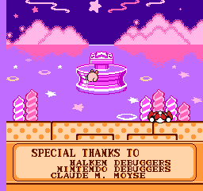

`./kd try --on cov2-save-finished@148830 --frames 60 --patch '13:B55E=$7D' --patch '13:B58B=$BF' --png unused/bank_ends-credits.png`

13:BF7D (`old_13_credits_2`) is an older copy of the second page of staff names in the demo that ends the game. It
reads SPECIAL THANKS TO / HALKEN DEBUGGERS / NINTENDO DEBUGGERS / CLAUDE M. MOYSE. The released page shows DAN
OWSEN in that row, and nothing else differs. The page before it (13:BF23) is a byte-for-byte copy of the live first
page. Both copies sit $B1 bytes after their live versions. Claim `bank_ends.credits.copy`.

Claude M. Moyse wrote for the German *Club Nintendo* magazine, including the 1996 Kirby comic *Kirbys Grösster Fall*
([Kirby Wiki](https://kirby.fandom.com/wiki/Kirby%27s_Biggest_Case)). Together with the German texts below, this
suggests the older build was a German localization, crediting its translator where the US release credits its
own. That reading is an inference from the ROM. Whether a released European version shows the name is not
checked here, because the project has only the US ROM.

### German pause texts

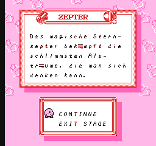

`./kd try --on cov4-d-pause@2990 --frames 80 --patch '38:B45C=$63' --patch '38:B477=$BF' --png unused/bank_ends-zepter.png`

Bank 38's end holds two texts and a routine from the older build:

- 38:BF21: the end of a German version of pause text 24, "Nun kannst Du auf [4] verschiedene Arten angreifen".
- A complete packed text for the Star Rod: ZEPTER, "Das magische Sternzepter bekämpft die schlimmsten Alpträume, die
  man sich denken kann". The font has no ä, and tile $C5 draws as a red bar.
- `pause_unpack` with its jump pointing $43 bytes higher.

Bank 35's end keeps the last 18 bytes of an older minigame menu stream, where the live one says QUIT and this one
says …ASSEN (VERLASSEN?). Claim `bank_ends.pause_de.patch`.

### An older swim stroke

18:B699 is a 751-byte older copy of 18:B3AA-B698: the swallow scripts, the mouth-full water states, the swim gravity
and the bump. Apart from relocated addresses, one value differs. A swim stroke with the mouth full set Kirby's
vertical speed to $FF1A (-0.90 px per frame), where the released game uses $FF40 (-0.75). Claim
`bank_ends.kirby18.copy`.

Other older copies:

- the ending's palette and fade code, with THE END (2E:BC3D);
- the rematch tables (3D:BF57);
- a sound-frame helper (3F:F8E7);
- `obj_land_old` (3F:F0A2), the object landing test as one routine, before it was split into bank 22's
  `obj_test_land` and `obj_floor_approach`. It accepts any distance of 0 or more as landed (now 0-8), and has no
  8-pixel depth limit. Patched in, objects still land (`dead_sys`).

### Noise

43 regions, 22,539 bytes in all, are no code, no table and no copy. Bits of mask $55 are set 1.6 times as often as
bits of mask $AA, and even addresses have 1.6 times as many set bits as odd ones (both ratios are about 1 in the rest
of the ROM). How full of set bits the noise is changes by groups of banks. No 16-byte run of it occurs twice.
This is what uninitialised memory looks like, written into the ROM image by the build.

## Cut or unreachable

### A debug row picker in the goal game

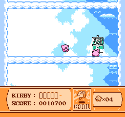

`./kd try --on main@2350 --frames 120 --patch 19:A0F5=3,0xA1 --input '.*70 A*1 .*5 A*1 .*5 S*1 .*77' --png unused/dead_kirby-goal-debug.png`

19:A103 (`goal_debug`) sits right after the jump table of the goal game's landing rows, and nothing names it. Every
frame it reads the pad:

- A and B step the landing row (0-6, wrapping);
- Select drops Kirby again on the chosen row, which then gives that row's dance and prize;
- Start ends the game.

Patched into entry 0 of the table, A, A, Select lands Kirby on row 2, and the score ends 300 points above the
untouched run. Claim `dead_kirby.goal_debug.effect`.

A similar picker for the level card (34:ACD1) steps `card_world` through 0-6 with A and B and ends the card with
Start. Nothing calls it (`dead_en2`).

### Kracko's floor breaker

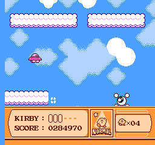

`./kd try --on main@59700 --frames 150 --input ".*150" --poke 620F=7 079E=0xC8 079F=0 07A1=0xE8 07A2=7 --png unused/dead_en2-kracko-floor.png`

Kracko has a state 7 in its state table, but nothing stores 7. Poked in, the following happens:

1. The eye flies back to where Kirby was when its last charge began.
2. It shakes and creates a block breaker.
3. The breaker erases the two-block column at that point, then every block of those rows to the left and right.

The claim sees 32 blocks of the cloud floor go. States 9 and $0A belong to the same path. Claim
`dead_en2.e3d_point`.

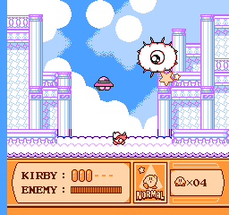

`./kd try --on main@60750 --frames 100 --patch 2F:B085=4 --png unused/dead_en2-kracko-walker.png`

Kracko's attack choice for a long fight (2F:B0D6) is never seen. Its attack 4 drops a small walker, at most two at a
time. Also unseen: a mirrored lightning sweep, with the X speeds negated.

### The cannon's other shots

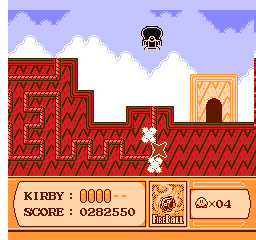

`./kd try --on cov3-a-cannon@60470 --frames 265 --patch '23:A6E7=3' --png unused/dead_en1-cannon-3.png`

The cannons have four shot kinds. Kind 0 fires Kirby up, and kind 1 fires him diagonally (world 6, never fired in a
movie). Two kinds can never be fired:

- Kind 2 fires him straight right, and no cannon is given kind 2.
- Kind 3 makes the cannon itself fly off, with no Kirby in it. Only an object kind that no room lists would use it.

Claims `dead_en1.cannon.kind1` to `kind3`.

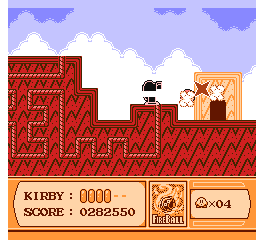

### Crane Fever: the sixth layout, and the claw with its doll

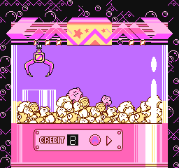

`./kd try --on cov-minigame-crane@3400 --frames 200 --patch '3B:B6EA=$A2,$14,$EA,$EA,$EA,$EA,$EA,$EA' --png unused/dead_sys-crane-layout6.png`

The crane's table of doll layouts holds all six orders of three places, but the game picks one with random(5), so
the sixth order (2, 1, 0) never comes up.

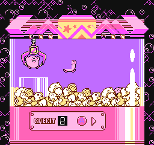

`./kd try --on cov-minigame-crane@3500 --frames 10 --patch '3A:89C0=$B5,$88' --png unused/dead_sys-crane-bigdoll.png`

Two pose tables (3A:87CE and 3A:88AF) draw the closed claw and its doll, small or big, as one picture. The game draws
the claw and the doll as two separate objects instead.

### Quick Draw's hats as background tiles

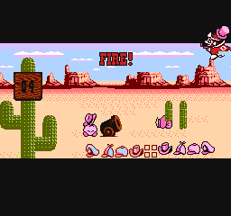

`./kd try --on cov-minigame-quickdraw@39900 --frames 2140 --patch '3C:ABD4=$4C,$E5,$AB' --png unused/dead_sys-qd-marks.png`

3C:ABE5 would draw one 2x2 hat for each decided round, as background tiles on the ground. The game draws its hats
as sprites (on the right). The fifth tile hat's tiles are not in the loaded graphics and show as boxes.

### Star Rod states no ability reaches

The Star Rod has a complete set of states for water, a ladder, dropping through a thin floor and bouncing after a
dive breaks a block (21:8DA5 onward). Each is a copy of the Hammer's state in the same place, with the rod's poses.
The rod is held only in the last fight, which has no water, ladder or thin floor. The one real change is in the rod's middle water-walk cycle, which steps
up twice and down twice, where the Hammer's steps up three times and back by 6.

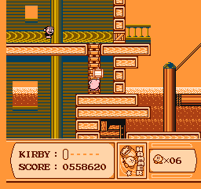

`./kd try --on cov4-c-hammer@91690 --frames 12 --patch 21:8DA5=0xF5 21:8E94=0xA6 --png unused/dead_kirby-rod-ladder.png`

Hammer Kirby on a ladder, running the rod's ladder state. The rod's pose numbers are drawn with the Hammer's sprite
map.

### Smaller things

- 22:9385: a script subroutine that writes an object's countdown into the lives counter every frame. Patched in, the
  HUD counts down from 60 (`dead_en1.lives_count.run`).

  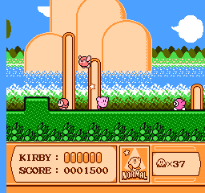
- 21:816F: a second slope table, entry n = 16·n·2/√5, the speed along a 1-in-2 slope. Nothing reads it. Pointed at, it makes Kirby run further up a 45-degree floor (`dead_kirby.slope2.table`).
- 16:B611: the Cutter's blade bouncing off a wall. Reached only from a never-run branch, it hops back under gravity
  and spins at a quarter speed (`unused/dead_kirby-cutter-wall.png`).
- The end of the Invincible Candy (the music comes back and the palette fades), a hurt Kirby falling into water, and
  grab throws that end at a ceiling or in water: Kirby's scripts that no state enters.
- Routines in the fixed bank that nothing calls: one counts an object's script threads (3E:D74C), and another,
  `obj_thread_nth`, has a bug: it overwrites its counter after one step.
- Script opcodes that no script uses: `add_e2`, `add_z`, `call_table_far`.
- An older 3x4 gravity table for Egg Catcher's eggs, a simpler camera for the crane, three Quick Draw parts that
  nothing creates, two type $0D effects, and sprite groups drawn mirrored where the draw routines mirror by
  themselves.

## Reachable, but never played

The corpus never went to these places. They are features of the released game, and a movie can reach them:

- **The Warp Star Stations** (rooms $1E-$24) are now in the corpus (`cov8-warp-star`, a ride from world 1's station to
  world 0's) and documented in unit cov8.
- The cannon's diagonal shot (kind 1) in world 6's room $A6.
- Sixteen of the pause screen's ability texts (Spark, Cutter, Sword, Laser, Mike, Sleep, Needle, Ice, Freeze, Ball,
  Tornado, Crash, Light, Back Drop, Throw, Star Rod). The Needle text writes "It's" with the font's lowercase l,
  which in this font looks nearly the same.
- Kracko steering at a Kirby who floats for 120 frames during the climb.
- The scene before the last fight, which every movie skipped with a button.
- Dropping through a thin floor with Sword, Hammer or Parasol.
- THE END's second set of twinkles, after 10,200 frames on that screen.
- B on the file select's file list (state 2), which goes back to the title. The corpus never entered that state. It
  is not yet established whether play can.
